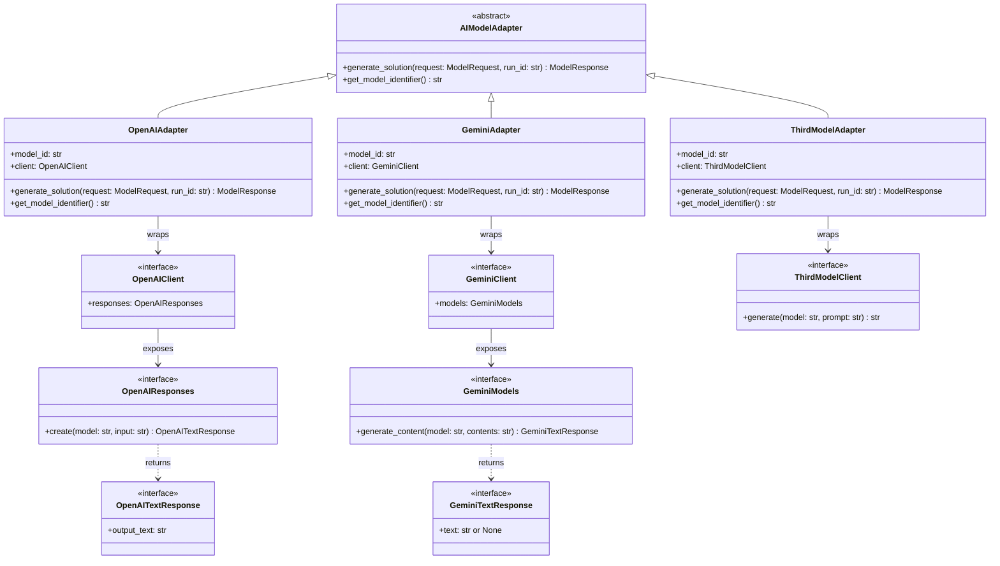
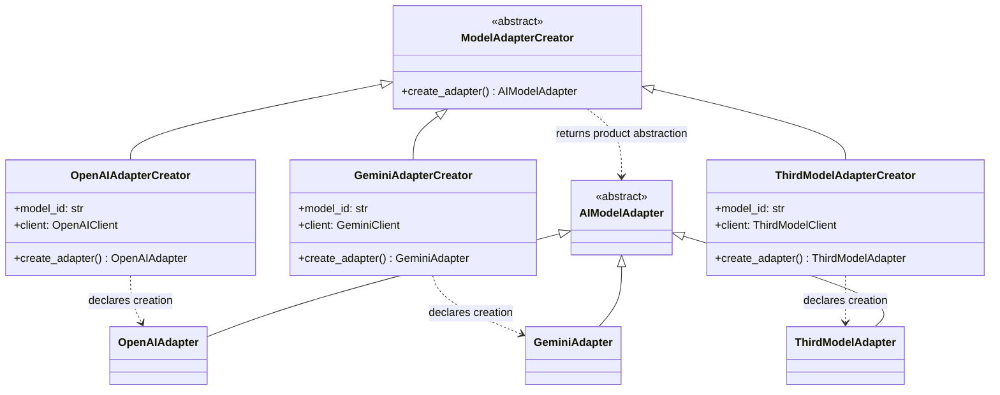

# AI model integration for Lab 04

This document describes the declarations for **AI-01 (Adapter)** and
**AI-02 (Factory Method)**. These patterns give orchestration a common model
interface and a replaceable creation interface. Their methods deliberately have
no functional implementation, as required by Lab 04.

## Public contracts and ownership

`taip.ai_integration.adapters.AIModelAdapter` is the only model-adapter
abstraction. It imports `ModelRequest` and `ModelResponse` from
`taip.common.contracts`; those shared definitions are unchanged.

The public operations are:

```python
generate_solution(self, request: ModelRequest, *, run_id: str) -> ModelResponse
get_model_identifier(self) -> str
```

The additional keyword-only `run_id` makes a gap in the conceptual UML explicit:
the shared response requires an application run identifier, while the shared
request has no such field. The caller supplies it. Adapters must eventually
preserve that identifier rather than generate another identifier or keep mutable
per-run state on a reusable client.

Each concrete adapter declares a configured `model_id` and a typed `client`
dependency. These attribute annotations express relationships; they do not
initialize instances. Future functional code must validate that the request,
adapter and response refer to the same configured model.

## Adapter



- **Target:** `AIModelAdapter`.
- **Adapters:** `OpenAIAdapter`, `GeminiAdapter`, `ThirdModelAdapter`.
- **Adaptees:** provider-facing client interfaces in `provider_clients.py`.
- **Client:** the future orchestrator, which consumes the target abstraction.

The local `Protocol` declarations describe narrow views of provider clients.
They require no installed SDK and are not complete replicas of SDK types. The
intended adaptation is:

| Adapter | Provider-facing input and operation | Provider-facing output |
|---|---|---|
| OpenAI | Approved request to text input for `client.responses.create` | `output_text` |
| Gemini | Approved request to content for `client.models.generate_content` | Optional `text` |
| Third model | Approved request to the proposed `client.generate` port | Text |

All outputs would eventually be normalized to the shared `ModelResponse` with
the caller's `run_id`, configured model identity and an execution status. No
translation, invocation or normalization occurs in these declarations. The third
provider and its actual API remain unselected; its port is a proposed interface.
Real SDK compatibility, missing text, refusals, incomplete output and provider
errors need functional tests when API integration is implemented.

## Factory Method



- **Creator:** `ModelAdapterCreator` in `creators.py`.
- **Concrete creators:** `OpenAIAdapterCreator`, `GeminiAdapterCreator`,
  `ThirdModelAdapterCreator`.
- **Product:** the existing `AIModelAdapter` imported from `adapters.py`.
- **Concrete products:** the corresponding three concrete adapters.

The base factory method returns the product abstraction. Concrete overrides use
the corresponding subtype as a covariant return annotation, making the intended
creator/product relationship explicit. No creation or configuration logic runs.
A future composition root selects a concrete creator; orchestration receives a
`ModelAdapterCreator` or an `AIModelAdapter`, without constructing vendor-specific
adapters. No orchestration implementation is added by these tickets.

## Boundaries and verification limits

1. Orchestration and problem management own **Save & Confirm**, snapshot
   validation/versioning, run identity and dispatch to the three configured
   models. A frozen snapshot alone is not proof of confirmation.
2. A single adapter represents one configured model. Provider errors must later
   remain attributable to that model/run, while orchestration preserves other
   results and calculates the overall status.
3. `ModelStatus.COMPLETED` describes execution, not mathematical correctness.
   Mathematical verification and comparison remain separate responsibilities.
4. The current shared response cannot distinguish timeout from another failure
   or carry detailed provider errors, latency or request IDs. Extending it
   requires a separate team-reviewed shared-contract change.
5. Benchmark tasks have their own domain and interface. A later benchmark-owned
   bridge may reuse provider clients; it must not invent confirmed user snapshots.
6. SDK dependencies, credentials, resource lifetime, transport retry budgets,
   asynchronous execution and AOP remain future integration work. There are no
   API calls, environment reads, network dependencies or generated-code execution
   in this module.

## Traceability

| Requirement | Structural evidence |
|---|---|
| AI-01 common interface and three adapters | One ABC and three typed concrete subclasses |
| AI-01 shared contracts | Direct imports from `taip.common.contracts` |
| AI-01 identifiable Adapter | Target inheritance, wrapped typed clients and adaptation mapping |
| AI-02 creator hierarchy | Abstract factory method and three concrete creators |
| AI-02 corresponding products | Covariant adapter return types and UML creation dependencies |
| AI-02 no duplicate target | Creators import the canonical target and products |
| Lab03 FR07–FR08 and NFR09 | Provider-neutral request/response boundary and replaceable dependencies |
| Lab04 declarations only | Structural and source-policy tests |

## Tests

All AI assertions and test utilities live in
`src/taip/ai_integration/testing`. A discovery-only hook in
`tests/test_ai_integration.py` includes them in the existing full-suite command.
The tests inspect declarations and relationships; they do not prove working API
calls, adaptation, factory construction or mathematical verification.

From the repository root, with Python 3.12 or later:

```powershell
$env:PYTHONPATH = "src"
python -m unittest discover -s tests -v
python -m unittest discover -s src/taip/ai_integration/testing -v
python -m compileall -q src tests
git diff --check
```

## Reference basis

The supplied Lab03 class diagrams 04 and 09 establish the abstract adapter and
three-model orchestration boundary. The AI-01/AI-02 cards specify the concrete
class names and creator hierarchy. These declarations refine that conceptual
design while retaining the shared Python contracts.

- [Python 3.12 abstract base classes](https://docs.python.org/3.12/library/abc.html)
- [Python 3.12 protocols](https://docs.python.org/3.12/library/typing.html#typing.Protocol)
- [OpenAI Python API reference](https://developers.openai.com/api/reference/python)
- [Google Gen AI Python SDK](https://googleapis.github.io/python-genai/)
- [Adapter](https://refactoring.guru/design-patterns/adapter)
- [Factory Method](https://refactoring.guru/design-patterns/factory-method)
