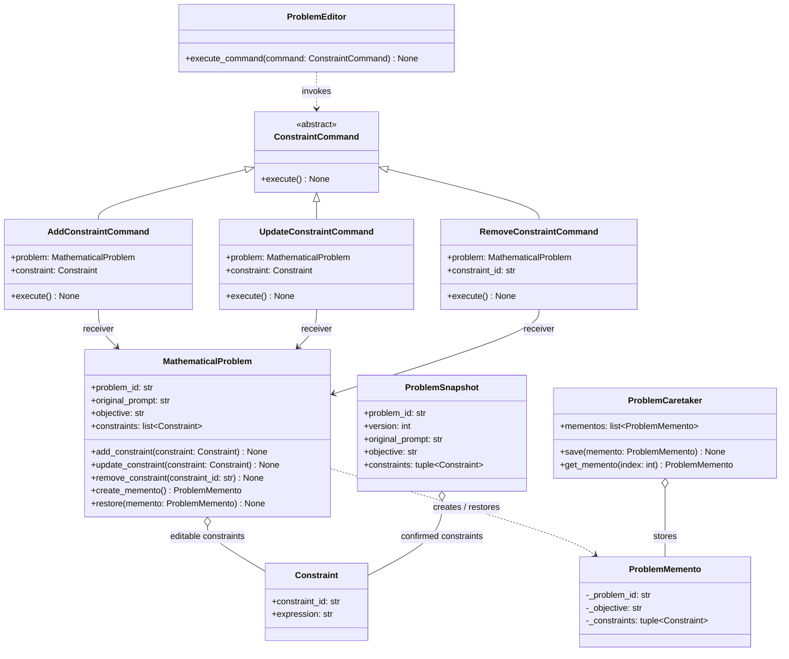

# Problem & Constraint Management — Lab 04

## Scope

This document describes the **structural design** of the Problem & Constraint Management module. It is based on the TAIP Lab 03 requirements and the Python class declarations developed for Lab 04. Method bodies are intentionally not implemented.

The module distinguishes **editable problem drafts** (`MathematicalProblem`) from **confirmed, versioned snapshots** (`ProblemSnapshot`). Only confirmed snapshots are intended to be consumed by the orchestration and model-integration modules.

## UML class diagram



## Design patterns

### Command (PROBLEM-01)

- **Command:** `ConstraintCommand` declares `execute()`.
- **Concrete commands:** `AddConstraintCommand`, `UpdateConstraintCommand`, `RemoveConstraintCommand` declare the corresponding operations and retain the receiver reference.
- **Invoker:** `ProblemEditor` accepts the command abstraction.
- **Receiver:** `MathematicalProblem` declares operations on its draft constraints.

**Rationale:** Editing actions are represented as separate objects. This keeps the editor decoupled from specific constraint-editing operations and allows future behavior to be added without changing the shared contracts.

### Memento (PROBLEM-02)

- **Originator:** `MathematicalProblem` declares `create_memento()` and `restore()`.
- **Memento:** `ProblemMemento` is a frozen dataclass representing a captured draft state.
- **Caretaker:** `ProblemCaretaker` declares storage and retrieval of captured mementos.

**Rationale:** The captured draft state is separate from the confirmed `ProblemSnapshot`, which preserves the distinction between editing history and a user-approved problem version.

## Architectural constraints and future work

1. `Constraint` and `ProblemSnapshot` are frozen dataclasses in the shared contracts; editing the draft must not mutate a previously confirmed snapshot.
2. A `ProblemMemento` is **not** a confirmed problem version and does not replace persistent version storage.
3. The design currently captures the objective, constraint collection and problem identifier. The team must explicitly decide whether `original_prompt` is immutable throughout editing or should also be captured before implementing restoration.
4. Class-level type annotations (for example, `mementos: list[ProblemMemento]`) are declarations, not initialized per-instance collections. Constructors and validation will be implemented in a later phase.
5. No command execution, draft restoration, confirmation gate or persistence logic is implemented in Lab 04.
6. AOP integration points, if required in later labs, can be considered around command execution, validation, logging and orchestration, subject to instructor approval of the Python approach.

## Traceability

- **Lab 03 FR03–FR04:** Review and edit constraints before confirmation — Command declarations.
- **Lab 03 FR05–FR06:** Explicit confirmation and a stored, versioned problem snapshot — separation of draft and `ProblemSnapshot`.
- **Lab 04 Problem 1:** Class, attribute, method and relationship declarations; two Design Patterns per team member.

## Verification

The existing structural tests (`tests/test_command_structure.py` and `tests/test_memento_structure.py`) inspect the class hierarchy and declarations. They do not verify runtime behavior. Run them from the repository root with Python 3.12:

```powershell
$env:PYTHONPATH = "src"
py -3.12 -m unittest discover -s tests -v
py -3.12 -m compileall -q src tests
```
